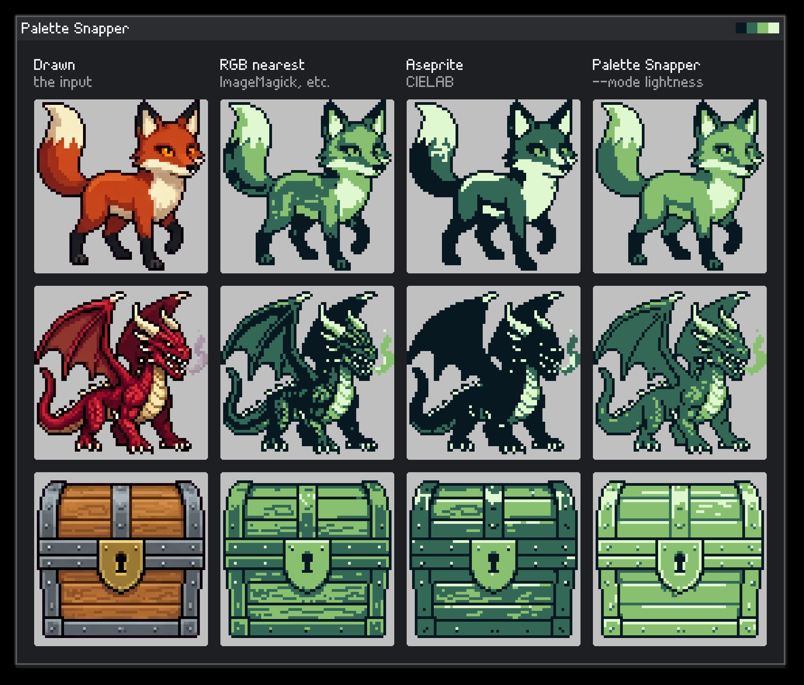

# Sprite Fusion Palette Snapper

- **Online version**: https://www.spritefusion.com/palette-snapper
- **API**: https://www.spritefusion.com/docs/pixel-art-generator/api/generate-and-transform-images#snap-to-a-palette
- **MCP**: https://www.spritefusion.com/docs/pixel-art-generator/api/mcp

Apply any palette to your pixel art, or reduce it to a few clean colors. Written in Rust, available as a CLI and a WebAssembly library.



<p align="center"><em>Palette: <a href="https://lospec.com/palette-list/nintendo-gameboy-bgb">Nintendo Gameboy (bgb)</a>, from Lospec. ImageMagick ran with <code>-remap</code> and no dithering.</em></p>

## Why ?

**1. Pixel art can have far too many colors.** A sprite from an image model, or one that was resized or saved as a JPEG, can look like it has twelve colors and really have hundreds to thousands. Palette Snapper merges similar ones into a few clean colors, at most 32 by default. Every color left was drawn: nothing is averaged or invented.

**2. <a href="https://www.spritefusion.com/palette-snapper"></a> a sprite needs a tool made for pixel art.** Palette Snapper merges near-identical shades before recoloring, so flat areas stay flat instead of speckled.

## Perfect for

- **AI generated pixel art** with hundreds of near-identical colors.
- **Sprites that must fit a palette**, a console's or your game's own.
- **Asset pipelines** using a native CLI or browser-based processing.

## How it works

### Reduce colors

- Similar colors merge into whichever of them appears most often, so every color left was drawn.
- Then the closest colors keep merging until at most 32 remain (set any number, or no cap).
- The threshold (default `0.03`) sets how similar two colors must be to merge: higher flattens the shading, lower keeps finer shades, up to the cap.

### Snap to a palette

Every visible pixel becomes one of the palette's colors, in one of two modes:

- `nearest` (default): each color becomes the palette color closest to it.
- `lightness`: the sprite's range from dark to light is spread over the palette's, and each color takes the palette color closest in lightness.

They give different results on different sprites and palettes: try both.

A palette can be hex colors, a palette file (Lospec `.hex`, Paint.NET `.txt`, GIMP `.gpl`, JSON) or an image of its swatches.

### How colors are compared

Every distance is measured in [OKLab](https://bottosson.github.io/posts/oklab/), a color space where equal distances look like roughly equal differences. In RGB they don't: two colors can be far apart and look alike, or close and look clearly different. So one threshold works about the same in shadows and in highlights.

### Output

- Fully transparent pixels are left as they are. Every other pixel, semi-transparent ones included, is recolored and keeps its alpha.
- Results with up to 256 colors are saved as indexed PNGs, which are smaller; others as regular RGBA PNGs.
- Faaast: a few ms a sprite.

## 💻 CLI

### Build from source

Requires [Rust](https://www.rust-lang.org/) 1.85 or newer. From this directory:

```bash
cargo build --release --locked
```

The binary is available at `target/release/spritefusion-palette-snapper`. To install it locally:

```bash
cargo install --path . --locked
```

### Usage

```text
spritefusion-palette-snapper <INPUT>... [OPTIONS]
```

- `<INPUT>`: PNG, GIF, WebP or JPEG images.
- `-o <OUTPUT>`: Output PNG for one input.
- `--output-dir <DIR>`: Output directory for a batch.
- `-p, --palette <PALETTE>`: Snaps to a palette: a palette file, an image of its swatches, or hex colors. Without a palette, the colors are reduced.
- `-m, --mode <MODE>`: With a palette, `nearest` or `lightness`. Defaults to `nearest`.
- `-c, --max-colors <COUNT>`: Without a palette, at most this many colors, or `none`. Defaults to `32`.
- `-t, --threshold <VALUE>`: Without a palette, colors closer than this become one color. Defaults to `0.03`.
- `--force`: Replace existing outputs. Input files are protected.

```bash
spritefusion-palette-snapper sprite.png -o clean.png
spritefusion-palette-snapper sprite.png -o clean.png --max-colors 16
spritefusion-palette-snapper sprite.png -o gameboy.png --palette gameboy.hex
spritefusion-palette-snapper sprite.png -o gameboy.png --palette gameboy.hex --mode lightness
spritefusion-palette-snapper sprite.png -o bw.png --palette "#000000,#ffffff"
spritefusion-palette-snapper sprites/*.png --output-dir clean --palette gameboy.hex
```

Without an output path, images are saved beside their inputs as `<name>_snapped.png`. Run `spritefusion-palette-snapper --help` for every option.

## 🌐 Web (WASM)

Build with the `wasm32-unknown-unknown` Rust target and [wasm-bindgen](https://wasm-bindgen.github.io/wasm-bindgen/) CLI `0.2.126`:

```bash
cargo build --release --target wasm32-unknown-unknown --no-default-features --locked
wasm-bindgen target/wasm32-unknown-unknown/release/spritefusion_palette_snapper.wasm --target web --out-dir pkg
```

Use the generated package in your project:

```js
import init, { reduce_colors, snap_to_palette } from "./pkg/spritefusion_palette_snapper.js";

await init();
const clean = reduce_colors(inputBytes, "{}");
const gameboy = snap_to_palette(inputBytes, "#081820,#346856,#88c070,#e0f8d0", JSON.stringify({ mode: "lightness" }));
// Both return PNG bytes.
```

Pass a `Uint8Array` and `"{}"` for default settings. `reduce_colors` takes `max_colors` (a number, or `null` for no cap) and `threshold`; `snap_to_palette` takes `mode`. A palette is hex colors or a palette file's text.

On a canvas, `reduce_colors_rgba` and `snap_to_palette_rgba` work on raw RGBA pixels:

```js
const pixels = context.getImageData(0, 0, canvas.width, canvas.height);
const snapped = snap_to_palette_rgba(pixels.data, pixels.width, pixels.height, "#081820,#346856,#88c070,#e0f8d0", "{}");
context.putImageData(new ImageData(new Uint8ClampedArray(snapped.buffer), pixels.width, pixels.height), 0, 0);
```

`parse_palette(text)` and `palette_from_image(bytes)` return a palette's colors as `#rrggbb` strings.

The CLI and WASM module give the same results, pixel for pixel. Inputs are limited to 64 MiB and 4,194,304 pixels.

## Development

```bash
cargo test --locked
cargo clippy --all-targets --locked -- -D warnings
cargo fmt --check
```

## Acknowledgments

Palette Snapper is a [Sprite Fusion](https://www.spritefusion.com/pixel-art-generator) project. Sprite Fusion is a tool to generate pixel art sprites and animations for game development.

## Other open source pixel art tools

- **[Sprite Normals](https://www.spritefusion.com/sprite-normals)**: generate normal maps for pixel art sprites and animations, so they react to dynamic lighting.


- **[Pixel Snapper](https://www.spritefusion.com/pixel-snapper)**: snap pixels to a perfect grid. Designed to fix messy and inconsistent pixel art generated by AI.


## License

[MIT License](LICENSE) — [Hugo Duprez](https://www.hugoduprez.com/).
